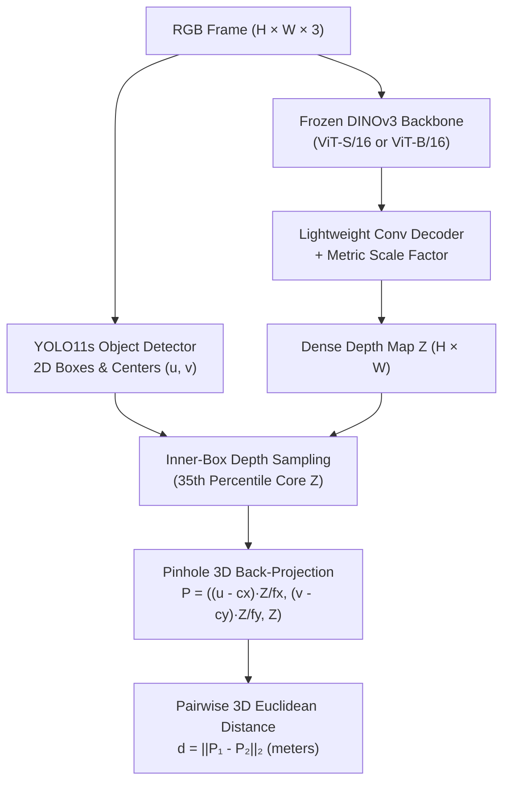
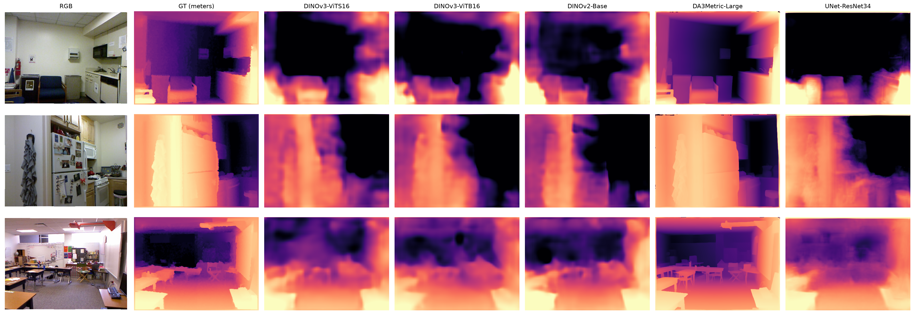
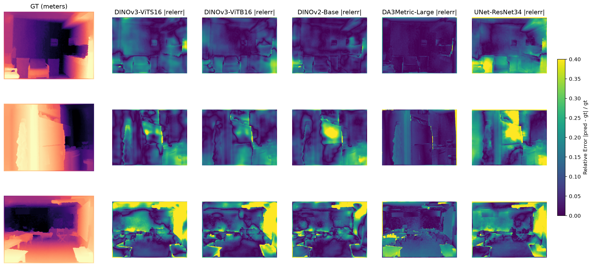
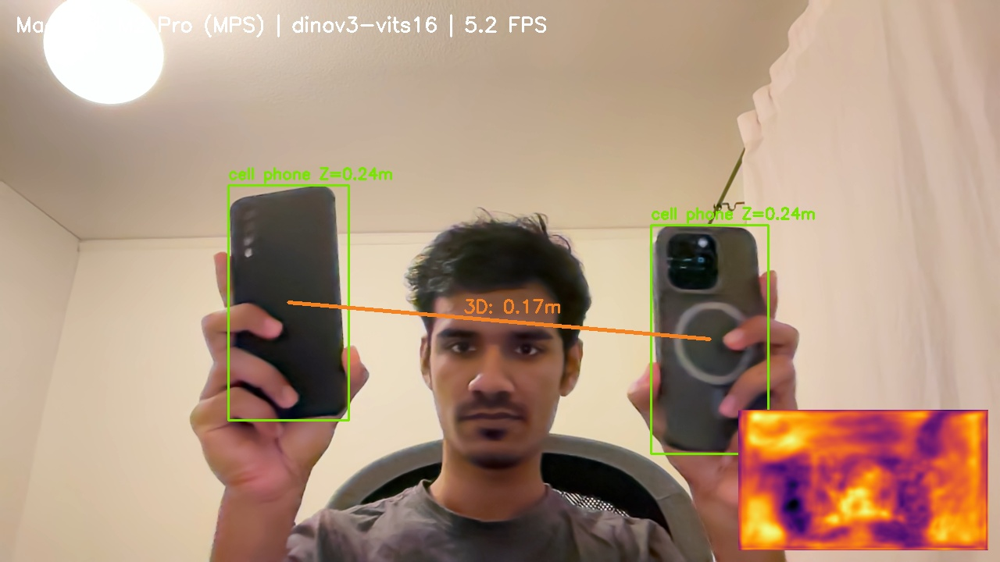
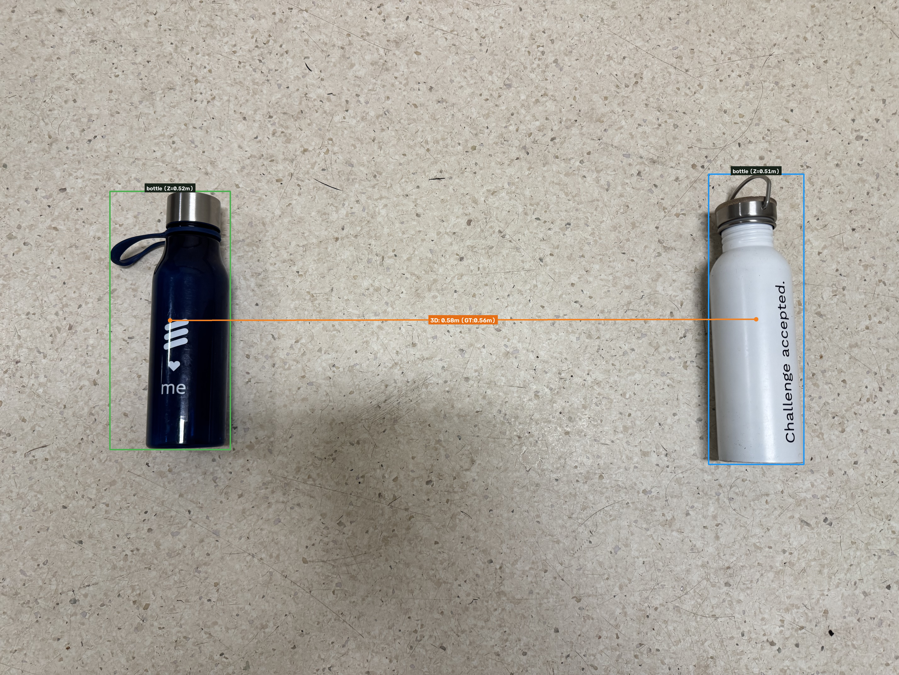
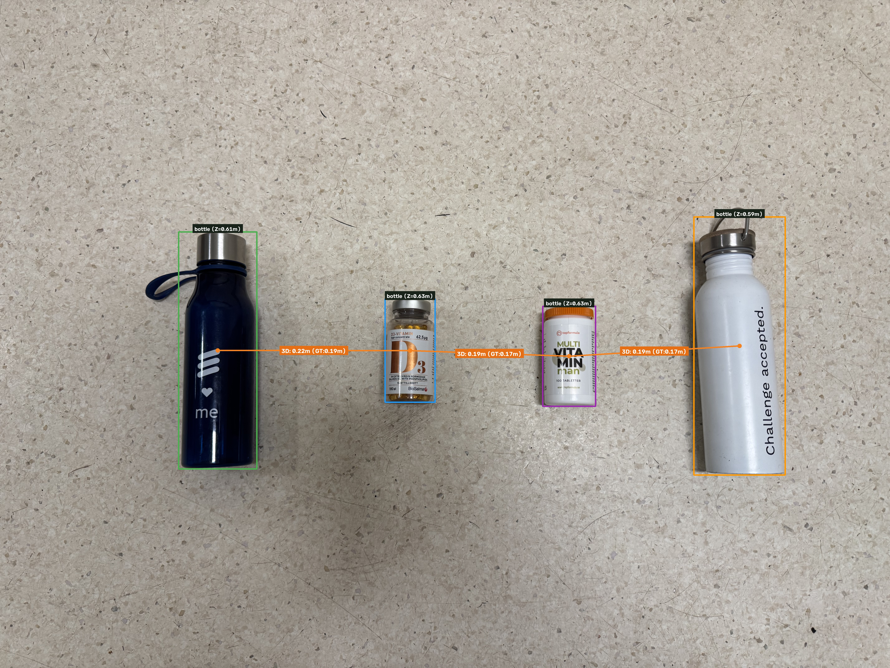
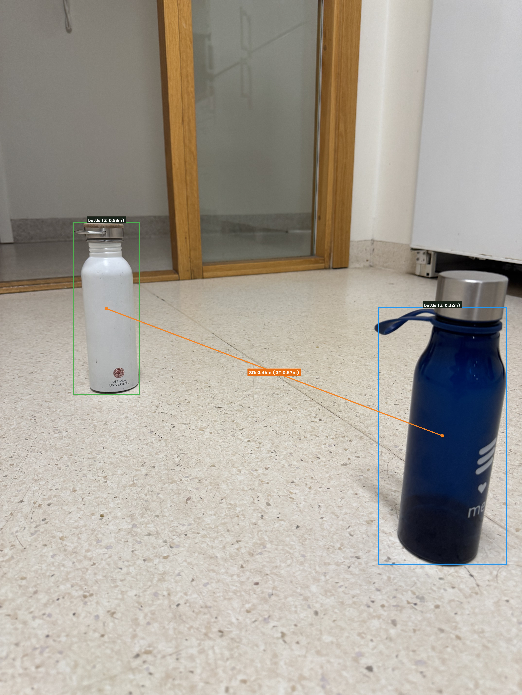

# Real-Time Monocular 3D Object Distance Estimation with DINOv3 & YOLO11

A computer vision pipeline that estimates scene depth from a single RGB image or live video stream, back-projects detected object centers into 3D camera coordinates, and computes real-time pairwise 3D Euclidean distances between objects (~27 FPS on Apple Silicon MPS).

**Pipeline Architecture:**



## Key Contributions

1. **NYU Depth v2 Benchmarking:** Evaluates frozen **DINOv3** backbones against **DINOv2**, **Depth Anything 3**, and a **ResNet-34 U-Net** baseline across 654 test images.
2. **Lightweight Multi-Scale Decoder:** Trains custom convolutional depth heads on top of frozen `DINOv3-ViT-S/16` and `DINOv3-ViT-B/16` representations.
3. **Physical Metric Calibration:** Validates predicted 3D object-to-object distances against physical tape-measure ground truth.
4. **Real-Time Edge Inference:** Combines `YOLO11s` and `DinoDepth` on Apple Silicon (`MPS`) with live iPhone Continuity Camera / webcam streaming.

## Repository Structure

```text
.
├── README.md
├── dinov3_depth_distance_v1.ipynb  # Main training, benchmark, and evaluation notebook
├── live.ipynb                      # macOS / iPhone live 3D distance demo
├── stream_iphone.py                # MJPEG camera server for remote/SSH streaming
├── nyu_results.csv                 # Complete NYU Depth v2 benchmark metrics
├── weights/
│   ├── head_dinov3-vits16.pt       # Trained ViT-Small depth head
│   ├── head_dinov3-vitb16.pt       # Trained ViT-Base depth head
│   └── yolo11s.pt                  # YOLO 11 object detector
└── outputs/
    ├── demo_thumb.jpg              # Live iPhone/webcam demo frame
    ├── nyu_qualitative.png         # RGB, ground truth, and model depth maps
    ├── nyu_errors.png              # Relative-error visualizations
    ├── nyu_rel_error.png           # Additional relative-error comparison
    ├── pred_2797.jpg               # Bottle distance example
    ├── pred_2801.jpg               # Multi-bottle distance example
    └── pred_2810.jpg               # Bottle distance example
```

## Method

### Depth Estimation

A frozen DINOv3 Vision Transformer (`dinov3-vits16` or `dinov3-vitb16`) serves as the visual backbone. Intermediate patch-token feature maps are extracted, reshaped into spatial grids, fused via a lightweight convolutional decoder, and upsampled to full image resolution. Backbone weights remain frozen throughout training.

### Object Detection & 3D Back-Projection

Ultralytics YOLO 11 (`yolo11s.pt`) detects objects in RGB frames. Depth $Z$ is sampled from the inner core of each bounding box to reject background bleed, and object centers $(u, v)$ are back-projected into 3D camera coordinates using calibrated pinhole intrinsics:

```text
X = (u - cx) * Z / fx
Y = (v - cy) * Z / fy
P = (X, Y, Z)
```

The 3D Euclidean distance between any two detected objects is computed as:

```text
distance = ||P1 - P2||₂
```

## Results

### NYU Depth v2 Benchmark (654 Test Images)

Custom depth heads were trained on 2,000 NYU Depth v2 training frames with frozen backbones and evaluated on the standard 654-image validation/test split:

- **AbsRel**: mean absolute relative error
- **RMSE**: root mean squared error in meters
- **δ1**: percentage of pixels satisfying `max(pred/gt, gt/pred) < 1.25`
- **ms/image**: depth-inference latency per frame

| Model | AbsRel ↓ | RMSE (m) ↓ | δ1 ↑ | ms/image |
|---|---:|---:|---:|---:|
| **DA3Metric-Large** *(zero-shot)* | **0.0766** | **0.3707** | **0.9259** | 11.49 |
| **DINOv2-Base + head** *(ours)* | **0.1109** | **0.4169** | **0.8795** | 4.43 |
| **DA3-Small** *(zero-shot)* | 0.1182 | 0.5236 | 0.8587 | 11.19 |
| **DINOv3-ViTB16 + head** *(ours)* | 0.1207 | 0.4502 | 0.8596 | 4.69 |
| **DINOv2-Small + head** *(ours)* | 0.1273 | 0.4656 | 0.8448 | 7.65 |
| **DINOv3-ViTS16 + head** *(ours)* | 0.1422 | 0.5186 | 0.8107 | 9.82 |
| **UNet-ResNet34** *(baseline)* | 0.2117 | 0.7608 | 0.6774 | **4.21** |

The complete benchmark—including unaligned (`none`) measurements—is available in [`nyu_results.csv`](nyu_results.csv).

#### Qualitative NYU Comparison



#### Relative-Error Comparison



### Real-World Object Distance Evaluation

Still-image physical tests measured known tape-measure ground-truth distances (0.25 m–0.50 m) between bottle targets:

- **DINOv3-ViTB16 + head:** **12.67 cm** mean absolute error (**40.8%** mean relative error)
- **DA3Metric-Large (baseline):** **4.03 cm** mean absolute error (**13.0%** mean relative error)

### Live Demo



The live pipeline detects objects, annotates per-object metric depth $Z$, draws pairwise 3D distance lines in real time, and renders a colorized depth map picture-in-picture overlay.

### Still-Image Outputs







> **Note on Calibration:** Metric accuracy depends on camera focal length (`F_PX`), depth scale factor, image resolution, and bounding-box depth sampling. Scale factors must be calibrated when switching cameras.

## Setup & Usage

### 1. Install Dependencies

```bash
pip install torch torchvision torchaudio
pip install timm ultralytics opencv-python numpy pandas pillow matplotlib tqdm datasets huggingface_hub flask
```

For gated DINOv3 checkpoints on Hugging Face, authenticate first:

```bash
huggingface-cli login
```

### 2. Run the Benchmark & Evaluation Notebook

Open [`dinov3_depth_distance_v1.ipynb`](dinov3_depth_distance_v1.ipynb) in Jupyter or VS Code and run the cells sequentially. Ensure your working directory is the repository root so checkpoints load from `weights/`:

```python
yolo = YOLO("weights/yolo11s.pt")
CKPT_PATH = f"weights/head_{MODEL_KEY}.pt"
```

### 3. Run the Live macOS / iPhone Demo

Open [`live.ipynb`](live.ipynb) and run the live cell:

- Automatically uses Apple Metal (`MPS`) when available
- Connects to iPhone Continuity Camera (`index 1`) or falls back to the MacBook webcam (`index 0`)
- Defaults to `dinov3-vits16` (`SCALE_FACTOR = 0.3729`) for ~27 FPS live inference, or switch to `dinov3-vitb16` (`SCALE_FACTOR = 0.3695`) for higher accuracy
- Automatically stops after `MAX_SECONDS` and saves `demo_thumb.jpg`

### 4. Stream iPhone Camera Over HTTP (Optional)

Run [`stream_iphone.py`](stream_iphone.py) to expose your macOS/iPhone camera over a local MJPEG stream:

```bash
python stream_iphone.py
```

- Continuous MJPEG stream: `[http://127.0.0.1:8080/video](http://127.0.0.1:8080/video)`
- Single JPEG snapshot: `[http://127.0.0.1:8080/frame.jpg](http://127.0.0.1:8080/frame.jpg)`

## Acknowledgments

## Author & Context

Developed by **Md Fahim** as part of the **HT2026 Group D DINOv3 Comparative Study** (Contemporary Methods in Visual Data Processing 1MD049, Uppsala University), focusing on real-time monocular 3D object distance estimation alongside parallel team studies in drone tracking, loop closure, and medical imaging.